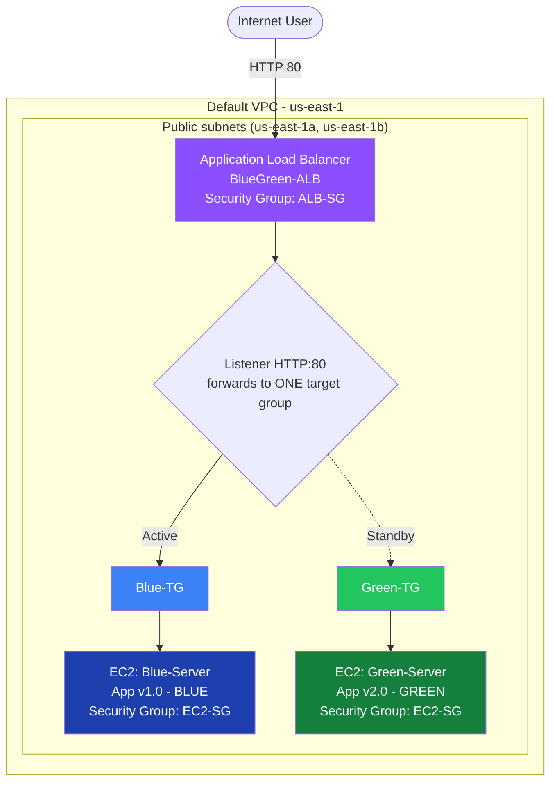
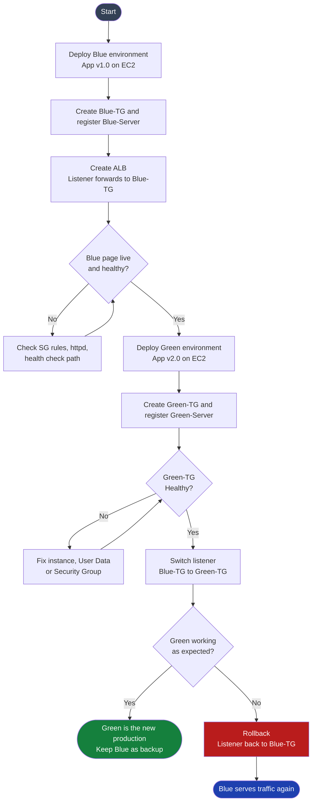
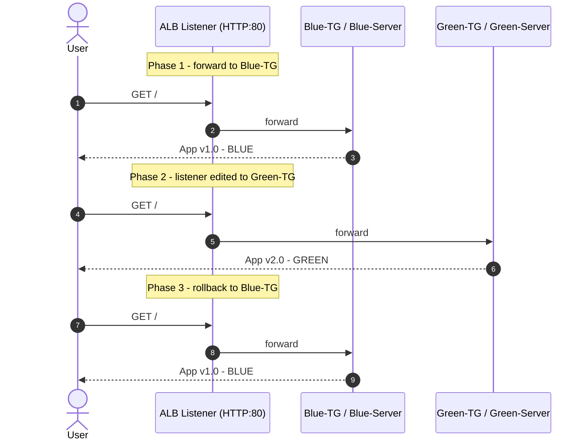

<h1 align="center">Blue-Green Deployment on AWS</h1>

<p align="center">
  Zero-downtime releases with instant rollback using <b>EC2</b>, <b>Application Load Balancer</b> and <b>Target Groups</b>
</p>

<p align="center">
  
  
  
  
  
  
</p>

---

## Table of Contents

1. [Overview](#overview)
2. [Architecture](#architecture)
3. [Deployment Flow](#deployment-flow)
4. [Traffic Switch Sequence](#traffic-switch-sequence)
5. [Tech Stack](#tech-stack)
6. [Security Design](#security-design)
7. [Implementation Steps](#implementation-steps)
8. [Results](#results)
9. [Key Learnings](#key-learnings)
10. [Future Improvements](#future-improvements)
11. [Cleanup](#cleanup)
12. [Author](#author)

---

## Overview

**Blue-Green deployment** is a release strategy that runs two identical production environments side by side:

| Environment | Version | Role |
|---|---|---|
| 🔵 **Blue** | App v1.0 | Current live version |
| 🟢 **Green** | App v2.0 | New version, tested before going live |

Traffic is moved from Blue to Green by changing **one ALB listener rule**. If anything goes wrong, pointing the listener back to Blue is the rollback. No downtime and no redeploy.

**Why this matters**

- Zero downtime during releases
- Instant rollback (seconds, not minutes)
- New version can be verified in a production-like environment before the switch
- Old version stays untouched until you are confident

---

## Architecture



---

## Deployment Flow



---

## Traffic Switch Sequence



---

## Tech Stack

| Layer | Technology |
|---|---|
| Cloud platform | AWS (AWS Academy Learner Lab) |
| Region | `us-east-1` (N. Virginia) |
| Compute | EC2, Amazon Linux 2023, t2/t3.micro |
| Web server | Apache `httpd`, installed via EC2 User Data |
| Load balancing | Application Load Balancer (Layer 7), 2 Target Groups |
| Networking | Default VPC, 2 Availability Zones |
| Security | 2 Security Groups with least-privilege rules |

---

## Security Design

| Security Group | Inbound rule | Source |
|---|---|---|
| `ALB-SG` | HTTP 80 | `0.0.0.0/0` (public) |
| `EC2-SG` | HTTP 80 | `ALB-SG` only |

EC2 instances accept traffic **only from the load balancer**, so they cannot be reached directly from the internet on port 80.

---

## Implementation Steps

<details>
<summary><b>1. Create Security Groups</b></summary>

- `ALB-SG`: inbound HTTP (80) from `0.0.0.0/0`
- `EC2-SG`: inbound HTTP (80) with source `ALB-SG`
</details>

<details>
<summary><b>2. Launch EC2 instances</b></summary>

Amazon Linux 2023, `EC2-SG`, public IP enabled. User Data installs and starts `httpd` and writes the page.

- `Blue-Server` serves `App v1.0 - BLUE Environment`
- `Green-Server` serves `App v2.0 - GREEN Environment`

**Blue User Data**

```bash
#!/bin/bash
dnf update -y
dnf install -y httpd
systemctl start httpd
systemctl enable httpd
cat > /var/www/html/index.html <<'HTML'
<html>
  <body style="background-color:blue; color:white; font-family:serif;">
    <h1>App v1.0 - BLUE Environment</h1>
  </body>
</html>
HTML
```

For Green, change `blue` to `green` and the heading to `App v2.0 - GREEN Environment`.
</details>

<details>
<summary><b>3. Create Target Groups</b></summary>

- `Blue-TG` with Blue-Server
- `Green-TG` with Green-Server
- Protocol HTTP:80, health check path `/`, default VPC
</details>

<details>
<summary><b>4. Create the Application Load Balancer</b></summary>

- Name `BlueGreen-ALB`, internet-facing, IPv4
- Subnets in `us-east-1a` and `us-east-1b`
- Security group `ALB-SG`
- Listener `HTTP:80` forwarding to `Blue-TG`
</details>

<details>
<summary><b>5. Switch to Green</b></summary>

Load Balancers, `BlueGreen-ALB`, Listeners and rules, `HTTP:80`, Manage listener, Edit listener, set default action to `Green-TG`, Save changes. Hard refresh the browser (`Ctrl + Shift + R`).
</details>

<details>
<summary><b>6. Rollback to Blue</b></summary>

Edit the same listener again and set the default action back to `Blue-TG`. Save and hard refresh.
</details>

---

## Results

The **same ALB URL** served different versions depending only on the listener target.

| Stage | Result | Screenshot |
|---|---|---|
| 1. Initial state | Blue live, v1.0 |  |
| 2. Listener switched | Forwarding to Green-TG |  |
| 3. After switch | Green live, v2.0 |  |
| 4. After rollback | Blue live again, v1.0 |  |
| 5. Health | Blue-TG target Healthy |  |

---

## Key Learnings

- Traffic switching happens at the load balancer, so the old version stays untouched and ready for rollback.
- A target shows `Unused` until its target group is attached to a listener, then moves to `Healthy` once health checks pass.
- Restricting `EC2-SG` to `ALB-SG` keeps instances off the public internet.
- Browsers cache pages, so use a hard refresh or Incognito to verify a switch.
- Always check target health **before** switching the listener, otherwise users get 503 errors.

---

## Future Improvements

- [ ] Weighted routing for canary releases (for example 90/10)
- [ ] Auto Scaling Groups behind each target group
- [ ] HTTPS with AWS Certificate Manager
- [ ] Custom domain with Route 53
- [ ] CloudWatch alarms for automatic rollback
- [ ] Infrastructure as Code (Terraform or CloudFormation)
- [ ] CI/CD pipeline for automated deployments

---

## Cleanup

Delete in this order to avoid charges (the ALB is billed hourly):

1. Application Load Balancer
2. Target Groups
3. EC2 instances (terminate)
4. Security Groups (`EC2-SG` first, then `ALB-SG`)
5. End the Learner Lab session

---

## Author

**Amisha Sinha**

[](https://github.com/amishasinha18)
